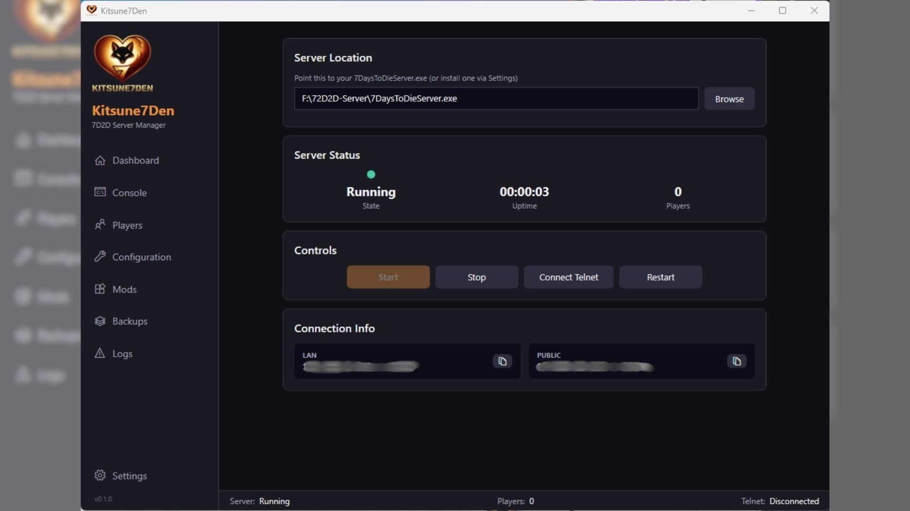
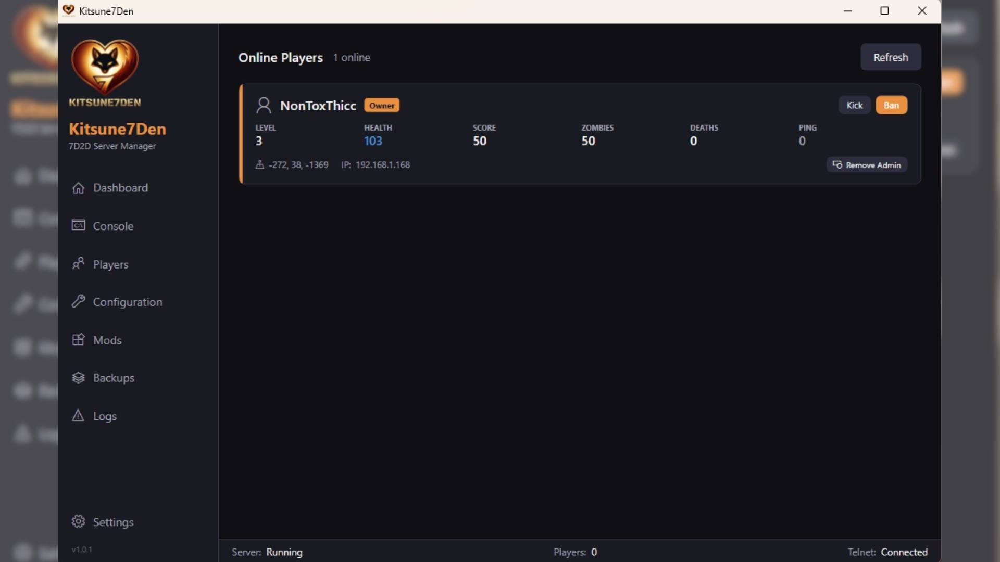
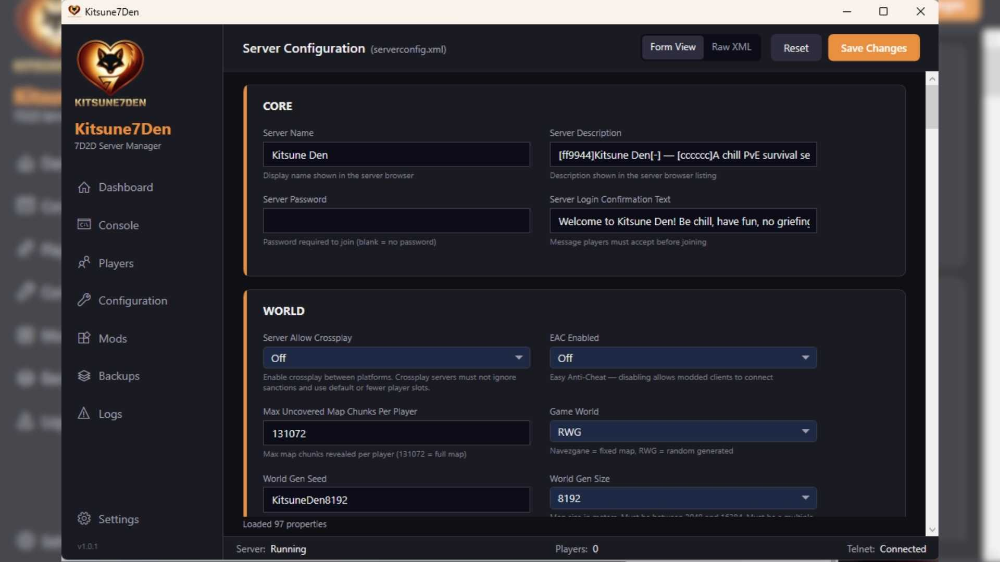
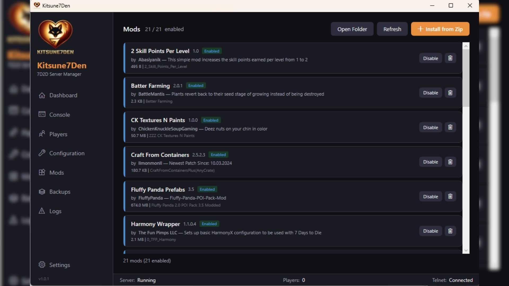
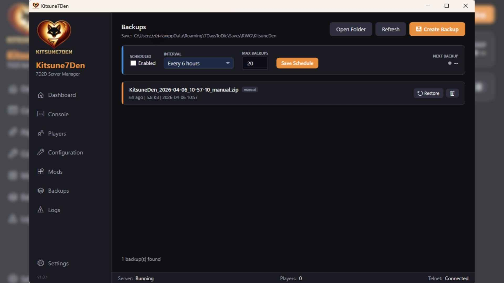

<p align="center">
  
</p>

<h1 align="center">Kitsune7Den</h1>
<p align="center"><strong>7 Days to Die Server Manager</strong></p>
<p align="center">A standalone Windows desktop app for managing your 7D2D dedicated server.<br/>No web stack. No browser. Just a simple exe.</p>

<p align="center">
  <a href="https://www.nexusmods.com/7daystodie/mods/10067"></a>
  <a href="https://github.com/Kitsune-Den/Kitsune7Den/actions/workflows/ci.yml"></a>
  <a href="https://github.com/Kitsune-Den/Kitsune7Den/releases/latest"></a>
  <a href="https://github.com/Kitsune-Den/Kitsune7Den/releases"></a>
  <a href="https://github.com/Kitsune-Den/Kitsune7Den/blob/main/LICENSE"></a>
  
  
  <a href="https://ko-fi.com/T6T57VRO7"></a>
</p>

---

## Features

- **Dashboard** -- Start/stop/restart server, connect telnet, view LAN/public IPs with click-to-copy
- **Console** -- Live server log tailing + telnet command input with history
- **Players** -- Player cards with stats, admin badges, kick/ban, give/remove admin via serveradmin.xml
- **Configuration** -- Grouped form editor with 90+ properties, smart dropdowns, Raw XML toggle
- **7 Days to Die 3.x** -- Detects your server's game version, edits the 3.x `SandboxCode` with a full Sandbox editor and the built-in presets, and updates pre-3.0 configs in one click
- **Mods** -- List installed mods, enable/disable, delete, install from zip
- **Backups** -- Manual + scheduled backups, restore with automatic safety backup, auto-prune
- **Logs** -- Browse all server log files with dropdown selector and text filter
- **Settings** -- SteamCMD install/update, auto-update on start, telnet config
- **Themes** -- 4 live-swappable themes (Kitsune, Midnight, Forest, Accessible/colorblind-friendly)
- **Languages** -- English and Simplified Chinese (简体中文), switchable live
- **Config Protection** -- Automatically backs up serverconfig.xml before Steam updates, restores after

## 简体中文

Kitsune7Den 支持简体中文。首次运行时会跟随 Windows 显示语言，也可以随时在 **设置 → 外观 → Language / 语言** 中切换，无需重启。服务器配置和沙盒选项使用游戏官方的中文译名，并保留原始属性名（例如 `玩家杀戮 (PlayerKillingMode)`），方便对照 `serverconfig.xml`。

支持七日杀 3.x（已在 3.3 上测试）：自动识别游戏版本，提供完整的沙盒选项编辑器（SandboxCode），并可一键将 3.0 之前的配置更新为 3.x 格式（会先备份）。

翻译有问题或想补充？欢迎提交 [Issue](https://github.com/Kitsune-Den/Kitsune7Den/issues)。

## Screenshots

### Dashboard
Start/stop/restart the server, view uptime, and copy LAN/public addresses in one click.



### Players
Live player cards with stats, admin badges, and one-click kick/ban/admin toggle — reads and writes `serveradmin.xml` directly.



### Configuration
Grouped form editor for every property in `serverconfig.xml`. Smart dropdowns, auto-discovered world list, day/night calculator, raw XML toggle.



### Mods
Card-based mod browser reading `ModInfo.xml`. Enable, disable, delete, or install directly from a zip.



### Backups
Manual or scheduled backups of your save. Restore with an automatic safety backup. Auto-prunes old backups.



## Quick Start

1. Download `Kitsune7Den.exe` from [Releases](https://github.com/Kitsune-Den/Kitsune7Den/releases)
2. Run it — *if Windows shows a SmartScreen warning, see [INSTALL.md](INSTALL.md) for why and how to proceed*
3. Browse to your `7DaysToDieServer.exe`
4. Hit Start

## Building from Source

Requires [.NET 8 SDK](https://dotnet.microsoft.com/download/dotnet/8.0).

```bash
dotnet build
dotnet run --project src/Kitsune7Den
```

To publish a single-file exe:

```bash
dotnet publish src/Kitsune7Den -c Release -r win-x64 --self-contained -p:PublishSingleFile=true -o ./publish
```

## Tech Stack

- .NET 8 / WPF / MVVM (CommunityToolkit.Mvvm)
- Telnet client for server commands + player data
- XDocument for serverconfig.xml + ModInfo.xml + serveradmin.xml parsing
- .resx string tables (`Resources/Strings*.resx`) with a live-switching `{l:Tr Key}` markup extension
- 7D2D 3.x Sandbox option tables (`Resources/Sandbox/`), generated from the game assembly by PackRelay's extractor; never hand-edit them, the order is the code format
- SteamCMD integration for server install/update

## Support the project

Kitsune7Den is free and open source. If it saves you time or makes your server life easier, you can buy me a coffee. No pressure, only gratitude.

<p align="center">
  <a href="https://ko-fi.com/T6T57VRO7"></a>
</p>

## License

MIT
